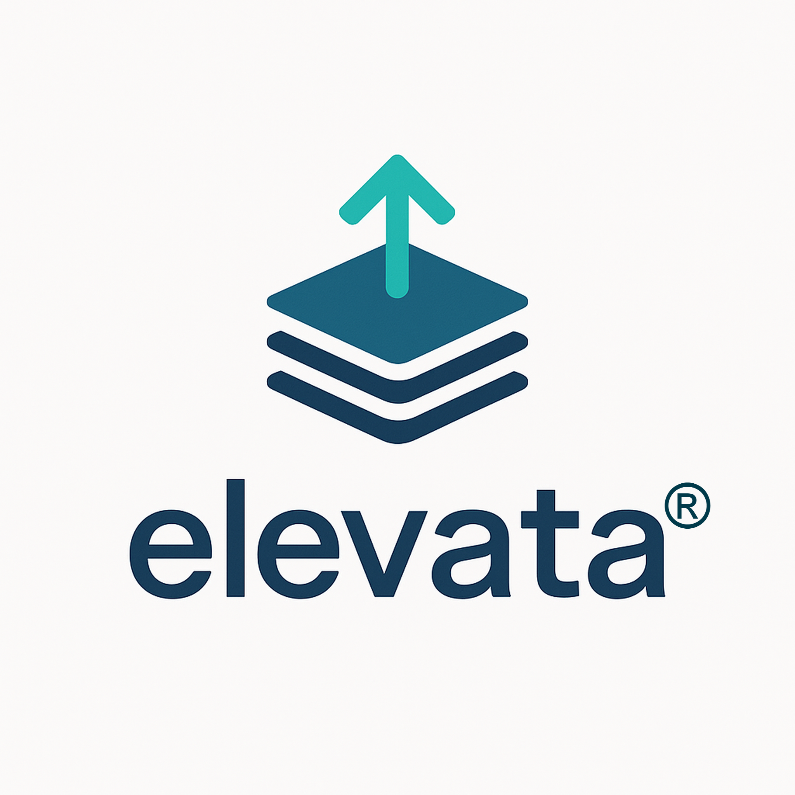
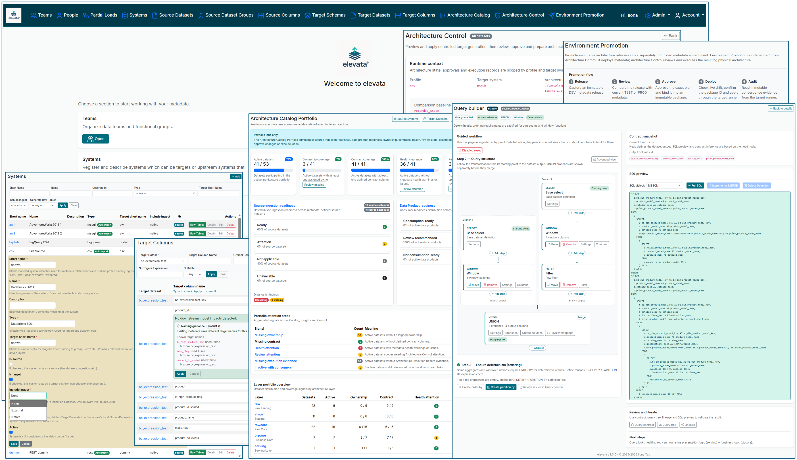

# elevata®

<p align="center">
  
</p>

**elevata® is an Architecture Runtime for modern data platforms.**

It turns **metadata into deterministic, executable data architecture**.
Architecture is defined declaratively and executed consistently across data warehouses and lakehouses.

SQL becomes an artifact. Architecture becomes metadata.

---

## ⚡ What elevata enables

The same metadata-defined architecture can be rendered, reviewed, and executed consistently on:

Snowflake · Databricks · Fabric · MSSQL · Postgres · DuckDB · BigQuery

without rewriting logic or introducing dialect-specific modeling.

elevata separates:

- **Logical architecture**  
- **Dialect rendering**  
- **Execution backend**

This makes data architecture portable, reproducible, governable, and auditable.

## License & Dependencies

[](https://github.com/elevata-labs/elevata/blob/main/LICENSE)
[](https://www.djangoproject.com/)
[](https://htmx.org/)
[](https://getbootstrap.com/)

---

## 🧭 What is elevata?

elevata is an **Architecture Runtime** for metadata-defined data platforms.

It models datasets, lineage, contracts, governance, and execution semantics as explicit metadata.

From these definitions, elevata derives deterministic Target Generation Plans and SQL Logical Plans, creates immutable architecture releases for controlled Environment Promotion, renders dialect-owned SQL, reviews architecture changes, and executes platform-native pipelines through controlled runtime scopes.

Target metadata generation, schema evolution, incremental loads, historization, approvals, and execution evidence are planned, validated, and applied deterministically.

<p align="center">
  
  <br/>
  <em>elevata user interface spanning metadata management, Architecture Control, and controlled Environment Promotion.</em>
</p>


## ✨ Why elevata is different

Most data platforms encode architecture implicitly in SQL and pipeline code.

elevata makes architecture explicit.

- Metadata defines behavior.  
- Dialects own SQL shape.  
- Control makes changes reviewable and auditable.  
- Execution is deterministic, observable, and evidence-based.

The result is governed, explainable, portable, and executable data architecture.

---

> *Modern data platforms often fail not because of missing tools, but because*  
> *architecture, lineage, and governance are encoded implicitly in SQL and pipeline code.*  
> *elevata exists to make these concerns explicit, declarative, and reproducible.*

---

## 📖 Architecture Runtime Publications

The Architecture Runtime concept behind elevata is described in the publication section:

- [Architecture Runtime Manifesto](https://github.com/elevata-labs/elevata/blob/main/publications/architecture-runtime-publication/architecture-runtime-manifesto.md)  
- [Why Modern Data Platforms Need an Architecture Runtime](https://github.com/elevata-labs/elevata/blob/main/publications/architecture-runtime-publication/architecture-runtime-essay.md)

These publications explain why modern data platforms need metadata-defined, deterministic, controllable, executable, and auditable architecture.

---

## 🧩 Architecture Overview

The core elevata architecture pipeline consists of five explicitly separated layers:

1. **Metadata Model**  
2. **Controlled Target Metadata Generation**  
3. **Deterministic SQL Logical Plan**  
4. **Dialect Rendering**  
5. **Platform-Native Execution**

Each layer has its own contract. A Target Generation Plan describes metadata mutation; a SQL Logical Plan describes the query that is rendered and executed. Environment Promotion is a separate cross-environment control boundary that moves immutable portable metadata releases between authoritative metadata environments.

---

## 📚 Example Workflow

1. Import or define source metadata, lineage, contracts, and execution semantics  
2. Review source metadata import outcomes before generation  
3. Open **Review target generation** and inspect the dependency-ordered RAW, STAGE, and RAWCORE sequence  
4. Review the exact Source-to-Target plan, create a Generation Approval where required, and apply the plan through guarded metadata mutation  
5. Create an immutable **Architecture Release** from the converged authoring metadata  
6. Use **Environment Promotion** to review the release against TEST / PROD, approve the exact Promotion Plan, build an immutable Deployment Package, check live target drift, deploy metadata, and audit convergence evidence  
7. Discover the resulting architecture from Source Systems through Target Datasets to Data Products using Catalog, Portfolio, Insights, and Map  
8. Inspect generated SQL, lineage, contracts, health, quality review, reference integrity, and execution evidence  
9. Review the target environment's resulting physical architecture changes through Architecture Review Briefing and approve them through Architecture Control  
10. Bind scheduler-managed runs to an immutable Execution Run Plan and Planned Architecture State  
11. Execute approved or unchanged active scopes deterministically on your target platform  
12. Finalize structured outcomes so recorded Architecture State advances only after successful execution  
13. Audit execution through Run Plan evidence, Architecture Execution Records, load logs, snapshots, and target-side Promotion History

---

## 💻 Execution

Pipelines are executed dataset-driven and lineage-aware.

Execution supports full and incremental loads, historization, schema evolution, controlled reference members, and structured load logging.

Behavior is deterministic and observable.

Schema drift is reconciled through Architecture MigrationPlan-driven materialization:  
renames, adds, type evolution and controlled rebuilds are derived from architecture state, while destructive changes remain explicitly policy-gated.

Scheduler-managed execution is bound to an immutable **Execution Run Plan**. The plan fixes the active dataset scope, execution order, Execution Impact decisions, review context, and architecture fingerprints for one batch. It is stored together with a matching **Planned Architecture State** snapshot.

Each dataset task validates its metadata against the planned snapshot and writes structured scheduler-step outcome evidence. Finalization advances the recorded Architecture State only after every required outcome succeeds, and it persists exactly the architecture applied by that run. Metadata changes made after Run Plan creation remain visible as post-plan drift and become input for a new run rather than silently redefining the active one.

Execution manifests, Run Plans, and dataset tasks contain active TargetDatasets only. Inactive generated targets remain reviewable architecture history but cannot re-enter execution implicitly.

Controlled Reference Members complement modeled rawcore references. Default members are maintained as artificial fallback rows, inferred members can be created during child dataset loads when a modeled TargetDatasetReference explicitly enables them, and Default Member Fallback can map still-unresolved child reference keys to the parent default member. Parent datasets remain authoritative: a later parent full load can replace inferred members with real source-backed rows. When controlled reference completion is enabled, referenced parent datasets become execution dependencies so parent readiness is enforced before child loads.

---

## 🔎 Source Metadata Import Review

elevata makes source metadata import reviewable.

Metadata import results explain what was discovered across SQLAlchemy-backed systems, files and REST sources.  
Instead of showing only that columns were processed, elevata distinguishes whether source columns were created, actually changed, unchanged, removed, or need manual review.

This gives users immediate confidence after import:

- **Created** columns are new in elevata metadata.  
- **Changed** columns existed before and now differ from the previous technical metadata state.  
- **Unchanged** columns were checked and still match the previous metadata state.  
- **Removed** columns no longer exist in the imported source shape.  
- **PK columns** show detected primary key candidates.  
- **Needs review** highlights skipped datasets or unresolved metadata decisions.

The import review is deterministic, transient and read-only as a report. It does not introduce a new wizard, does not persist import history, and does not change the existing source import semantics.

---

## 🚦 Source & Ingestion Readiness

elevata makes the handoff from source metadata into executable architecture inspectable before load execution.

For each SourceDataset, Source Ingestion Readiness evaluates metadata-defined conditions such as lifecycle and integration scope, RAW landing intent, native or external ingestion mode, integrated SourceColumns, active RAW TargetDataset links, file or REST configuration shape, JSON paths and incremental policy requirements.

Readiness is expressed through transparent states:

- **Ready** - no blocking or warning signal is present.  
- **Attention** - metadata contains a blocking or warning signal that should be resolved or reviewed.  
- **Not applicable** - the dataset is inactive, outside integration scope, or intentionally uses direct or federated access without elevata-managed RAW landing.  
- **Unavailable** - the dataset cannot be evaluated as a valid source architecture object.

The same readiness semantics appear on SourceDataset detail pages, in the Architecture Catalog Source Systems view, in the Catalog Portfolio and in Source-to-RAW handoffs on the Catalog Map.

Readiness is deterministic and read-only. It does not connect to sources, resolve secrets, read files, call REST endpoints, import metadata, edit configuration or execute loads.

---

## 🧭 Architecture Catalog

elevata provides a read-only Architecture Catalog for discovering metadata-defined executable architecture from **Source Systems through Target Datasets to Data Products**.

Catalog, Portfolio, Insights and Map views bring together ownership, lineage, contracts, readiness, lifecycle, health, execution evidence and Architecture Control state. Source views expose ingestion readiness and RAW landing intent; Target Dataset views expose architecture and runtime posture; Data Product views derive trusted-consumption readiness from serving-layer metadata and evidence.

Catalog Detail also provides bounded, read-only **Architecture Quality Review** and **Reference Integrity Review**. These diagnostics inspect loaded target data against metadata-defined expectations without repairing data, creating reference members or mutating architecture. Controlled load execution remains responsible for enabled reference-member handling.

The Catalog does not edit metadata or execute loads. It is the discovery and trust surface for the architecture managed elsewhere by Target Generation, Environment Promotion, Architecture Control and runtime execution.

See the [Architecture Catalog documentation](https://github.com/elevata-labs/elevata/blob/main/docs/architecture_catalog.md).

---

## 🧭 Architecture Control

elevata makes target metadata generation and physical architecture changes reviewable before mutation or execution.

**Controlled Target Generation** turns source-to-target generation into an immutable, inspectable contract:

```text
Source Metadata
  ↓
Target Generation Plan + Review
  ↓
Generation Approval, when required
  ↓
Guarded Target Metadata Apply
  ↓
Architecture Change Report
  ↓
Architecture Approval
  ↓
Controlled or Scheduler Execution
```

Generation Approval and Architecture Approval remain intentionally separate: one authorizes the reviewed metadata mutation, the other authorizes the resulting physical architecture change.

Architecture State, Change Reports, Approval Artifacts, Execution Impact Plans, immutable Execution Run Plans, Planned Architecture State snapshots, structured outcomes and Execution Records expose deterministic fingerprints, policy decisions, review decisions and execution evidence. Architecture Review Briefing summarizes scope, change volume, policy posture, blocking signals and reviewer focus before approval or execution.

Generated TargetDatasets that leave the eligible source scope are retained as inactive architecture history rather than being deleted. If they become eligible again, the same metadata objects are reactivated. Execution manifests, Run Plans and runtime tasks remain active-only.

This keeps CI checks, scheduler integration, approvals, execution guardrails, architecture-state comparison and exact state finalization inside one controlled runtime model.

See [Architecture Control](https://github.com/elevata-labs/elevata/blob/main/docs/architecture_control_plane.md) and [Controlled Target Generation](https://github.com/elevata-labs/elevata/blob/main/docs/controlled_target_generation.md).

---

## 🚀 Environment Promotion

elevata extends deterministic control across separate metadata environments through **Controlled Environment Promotion**.

```text
Release → Review → Approve → Deploy → Audit
```

The authoring runtime captures one immutable portable Architecture Release, compares it with the current TEST / PROD metadata state through an authenticated headless Promotion Target Runner, approves one exact deterministic Promotion Plan, binds Release + Plan + Approval into an immutable Deployment Package, rejects live target drift, applies metadata transactionally, and records exact convergence evidence on the target.

DEV does not switch its metadata database connection to TEST or PROD and does not need target metadata DB credentials. Runtime profiles, providers, secrets, concrete connection strings, paths and pepper values remain environment-local.

Environment Promotion deploys **metadata only**. The resulting physical architecture is reviewed independently through Architecture Control in the target environment.

Three approval boundaries remain distinct:

- **Generation Approval** - authorizes one exact Source-to-Target metadata mutation inside an environment  
- **Environment Promotion Approval** - authorizes one exact release-to-environment metadata deployment  
- **Architecture Approval** - authorizes one exact resulting physical architecture change

See [Environment Promotion](https://github.com/elevata-labs/elevata/blob/main/docs/environment_promotion.md) for runtime topology, portable identity, artifacts, UI/CLI workflow, target runner security, drift/convergence semantics and the TEST / PROD operating model.

---

## 📐 Query Builder

elevata keeps complex transformation logic **explicit in metadata instead of hiding it in platform-specific SQL**.

The Query Builder separates relational query shape from calculated values: **FILTER, AGGREGATE, UNION, and WINDOW** define transformation steps, while structured Expressions define calculated values and predicates through platform-neutral contracts. Joins remain explicit dataset relationships so lineage and execution dependencies stay visible.

The visual Query Structure canvas follows the actual graph order and supports position-aware **Add, Move, and Remove** operations. Every graph mutation is validated against downstream query contracts and fails closed when a change would make the transformation invalid.

UNION branches converge through an explicit output contract. Reconciliation highlights valid mappings, safe same-name matches, stale mappings and datatype conflicts; safe matches add only missing deterministic mappings and never overwrite explicit user decisions.

Advanced Bizcore and Serving logic remains portable and reviewable:

- filters and calculated values use structured expression contracts rather than embedded SQL  
- aggregates support explicit group keys and measures, including ordered `STRING_AGG`, `COUNT(*)`, `SUM`, `AVG`, `MIN`, and `MAX`  
- window functions support partitioning, ordering, explicit frames, ranking, navigation, and windowed aggregates  
- UNION and UNION ALL compose independently shaped branches under one stable output schema  
- query-derived output contracts stay synchronized with physical materialization  
- SQL Preview uses deterministic structure-aware formatting for nested queries, joins, predicates, windows and unions without changing executable SQL semantics  

The same metadata-defined logic compiles into a vendor-neutral Logical Plan and is rendered by the active dialect. SQL remains inspectable, but it is the **artifact of the architecture - not the place where the architecture is defined**.

See [Query Builder & Query Tree](https://github.com/elevata-labs/elevata/blob/main/docs/query_builder_and_query_tree.md), [Expression DSL & AST](https://github.com/elevata-labs/elevata/blob/main/docs/expression_dsl_and_ast.md), and [SQL Preview Pipeline](https://github.com/elevata-labs/elevata/blob/main/docs/sql_preview_pipeline.md).

---

## 🏷️ Metadata Naming Guidance

elevata supports deterministic Metadata Naming Guidance while editing TargetColumns.

Guidance is derived from existing column mappings and previously used target names. It helps modelers reuse project-specific naming decisions without AI, without a global dictionary and without enforcing naming rules.

For direct source inputs, elevata uses the technical SourceColumn name. For upstream target inputs, it uses the immediate upstream TargetColumn name, so guidance follows the current modeling step instead of tracing back to the original source-system field.

Naming Guidance focuses on rawcore and bizcore technical naming decisions. Serving-layer friendly names and historized rawcore datasets are excluded from recommendation evidence.

Recommended names can be applied directly from the TargetColumn inline editor, but they remain advisory. Existing validation, collision checks and rename handling stay authoritative.

---

## 🔮 Roadmap

elevata evolves along four strategic axes:

**1. Architecture Discovery & Trust**  
Keeping executable architecture discoverable across datasets, lineage, contracts, ownership, readiness, quality review, reference integrity, health and execution evidence.

**2. Controlled Runtime Operation**  
Strengthening controlled target metadata generation, cross-environment metadata promotion, deterministic review, separate approval boundaries, immutable deployment and scheduler contracts, finalization, audit evidence, retention and runtime safety without adding unnecessary control layers.

**3. Source & Ingestion Readiness**  
Keeping source onboarding, RAW landing intent, ingestion modes, file/API patterns, external ingestion and federated access explicit, inspectable and deterministic.

**4. Platform Coverage & Runtime Hardening**  
Improving backend coverage, dialect behavior, schema evolution safety, historization, logging and reproducible execution across supported platforms.

See `/docs` for architectural depth.

---

### ♟️ Architecture & Strategy

For a deeper architectural and strategic overview of elevata’s direction,
see the [elevata Platform Strategy](https://github.com/elevata-labs/elevata/blob/main/docs/strategy/elevata_platform_strategy.md).

---

## 🛡️ Data Privacy (GDPR/DSGVO)

elevata itself does not require personal data.  
If used with customer datasets, responsibility for compliance remains with the implementing organisation.  
The system supports pseudo-key hashing and consistent pseudonymisation-oriented strategies via its hashing DSL.

---

## Disclaimer

This project is an independent open-source initiative.

- It is not a consulting service.  
- It is not a customer project.  
- It does not store or process customer data.  
- It is not in competition with any company.  

The purpose of elevata is to contribute to the community by providing an Architecture Runtime for metadata-defined data platforms.

The project is published under the AGPL v3 license and open for use by any organization.

---

## 🧾 License & Trademark Notice

© 2025-2026 Ilona Tag - All rights reserved.  
**elevata®** is an open-source software project for metadata-defined data architecture.

elevata® is a registered trademark in Germany.  
Other product names, logos, and brands mentioned here are property of their respective owners.

Released under the **GNU Affero General Public License v3 (AGPL-3.0)**.  
See [`LICENSE`](https://github.com/elevata-labs/elevata/blob/main/LICENSE) for terms and [`NOTICE.md`](https://github.com/elevata-labs/elevata/blob/main/NOTICE.md) for third-party license information.